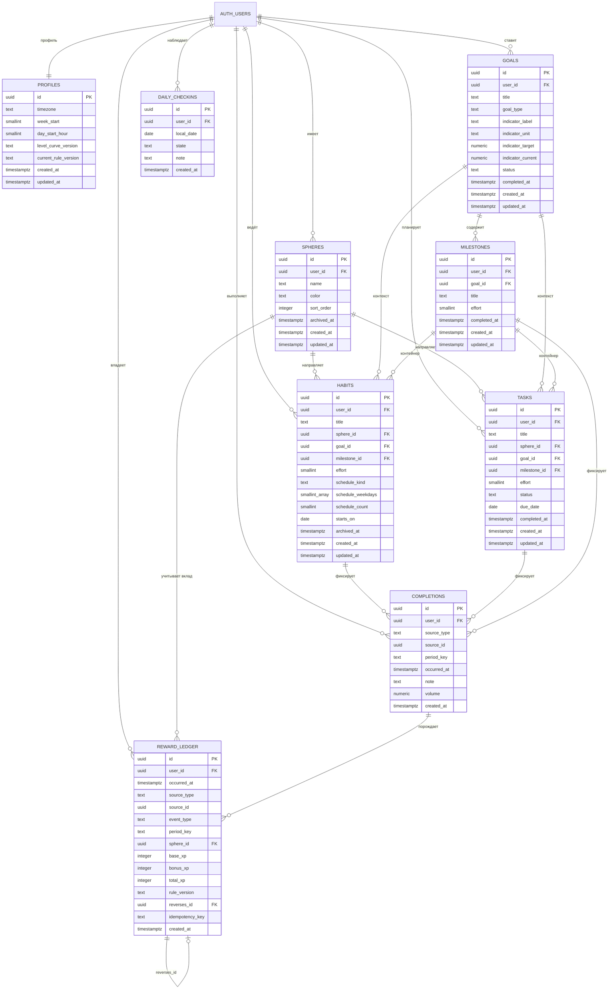
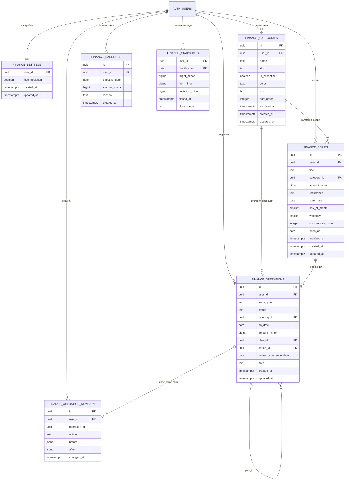
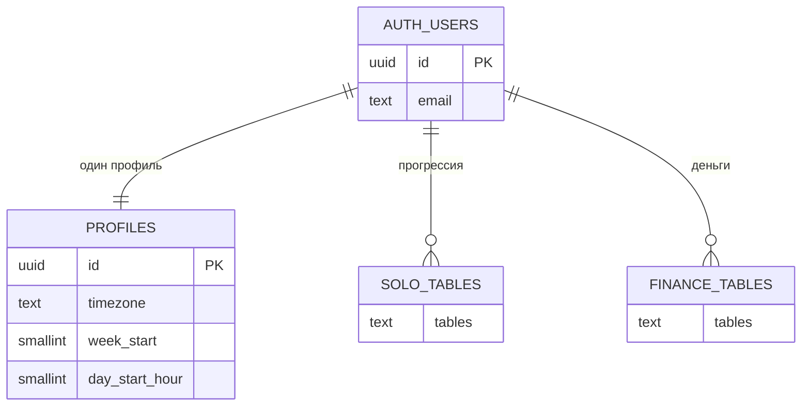

# ERD: схема базы данных

**Статус:** рабочий документ · версия 1.0  
**Связанные документы:** [`solo-schema.md`](solo-schema.md), [`finance-schema.md`](finance-schema.md), `../supabase-setup.md`

---

## 1. Как читать диаграммы

- `||--o{` — один к многим; `||--||` — один к одному.
- Пунктирная связь на диаграмме означает логическую связь без внешнего ключа.
- Все пользовательские таблицы связаны с `auth.users` через `user_id`; на диаграммах показан только верхний уровень, чтобы не повторять одну и ту же линию.
- `source_id` в `completions` и `reward_ledger` — полиморфная ссылка: она указывает на `tasks`, `habits` или `milestones` в зависимости от `source_type`. Обычного внешнего ключа по ней нет.

## 2. Solo: прогрессия

## 3. Finance: деньги

## 4. Связь двух направлений

Направления не связаны предметно: трата не даёт XP, сфера не влияет на баланс. Общая только инфраструктура — пользователь Auth, `profiles` (часовой пояс и настройки периода), RLS и миграции.

## 5. Ключевые решения схемы

| Решение | Причина |
| --- | --- |
| `reward_ledger` без `total_xp` у пользователя | Иначе два источника истины: сумма журнала и сохранённое число разойдутся |
| Уникальность награды на журнале, а не на `completions` | Дополнительные отметки привычки разрешены как статистика, но XP не удваивают |
| Полиморфный `source_id` без FK | Одна колонка указывает на разные таблицы; целостность обеспечивает `source_type` |
| План и факт — разные строки | Позволяет связать частичное исполнение и сохранить историю плана |
| Деньги в копейках `bigint` | Точное сложение без `float` |
| Снимок месяца — отдельная неизменяемая строка | Закрытый месяц не пересчитывается задним числом |
| Базовые линии и снимки неизменяемы | Иначе исправление одной строки молча переписывает историю |
| Ревизии операций вместо append-only операций | Опечатка в сумме — обычная ситуация; аудит важнее реверсов |
| RLS на каждой таблице | Ошибка изоляции данных между пользователями — самая дорогая из возможных |
