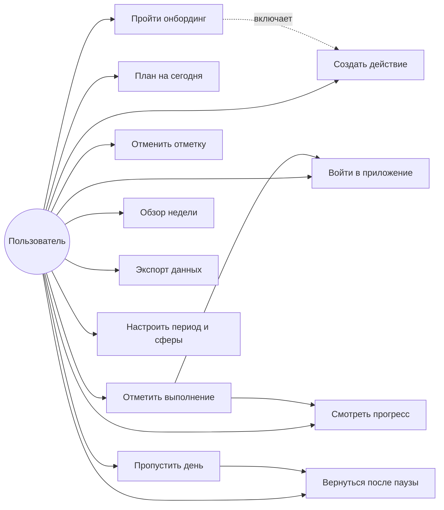
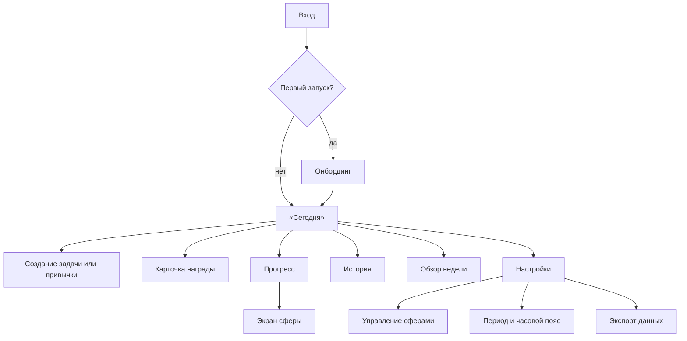
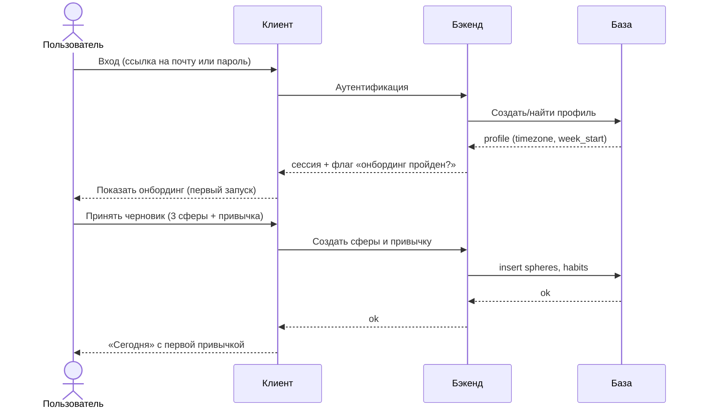
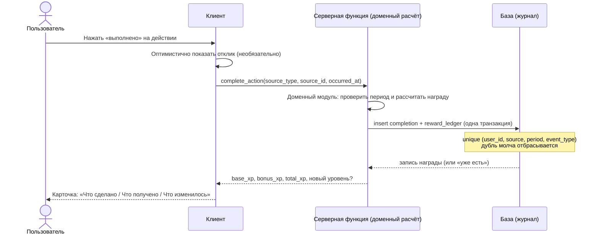
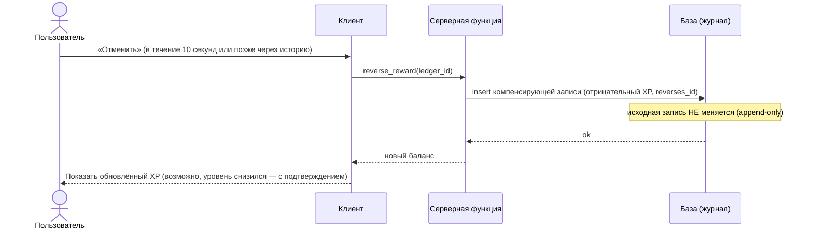
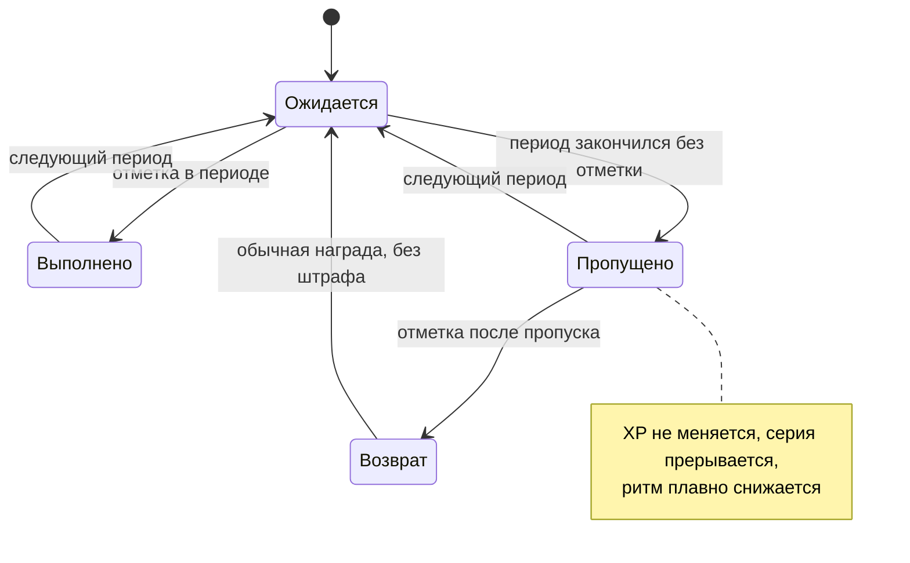
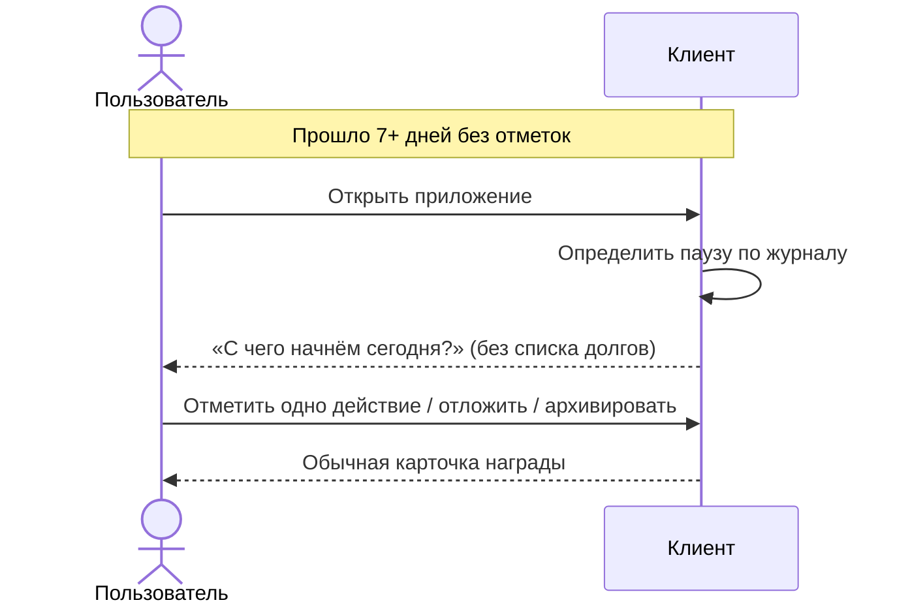
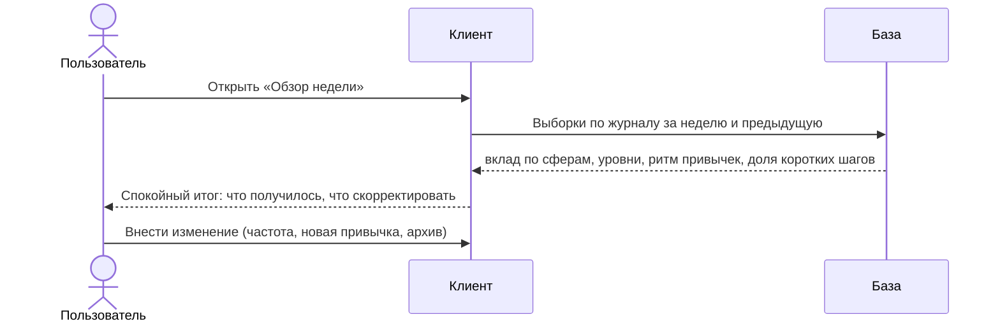
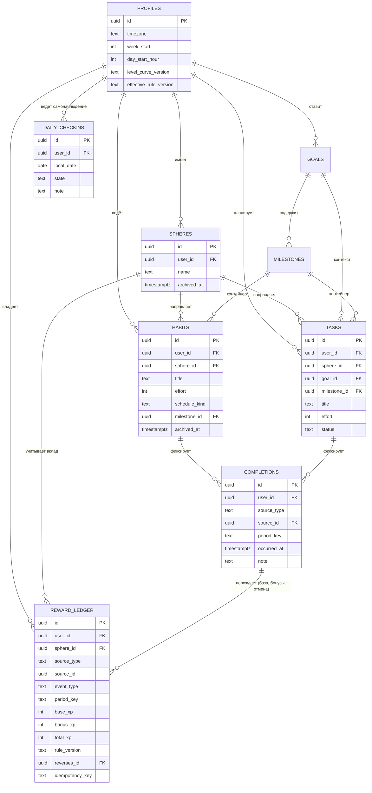

# Solo Level — пользовательские сценарии

**Статус:** рабочий документ · версия 0.1  
**Связанные документы:** `solo-level-product-foundation.md`, `solo-level-progression-system.md`, `solo-level-technical-architecture.md`  
**О диаграммах:** все схемы ниже написаны в формате Mermaid. GitHub отображает их прямо в файле; в других просмотрщиках нужен плагин Mermaid.

---

## 1. Назначение документа

Описать, как выглядит работа с приложением от первого входа до ежедневных действий: какие экраны, какие шаги, что происходит с данными. Это связующее звено между правилами прогрессии (что считается) и технической архитектурой (где хранится). Здесь не дублируются формулы XP — они в системе прогрессии, а награда объясняется только на уровне «что видит пользователь».

## 2. Действующие лица

| Актор | Кто это | Что делает |
| --- | --- | --- |
| Пользователь | Автор проекта (пока единственный) | Входит, планирует, отмечает выполнение, смотрит прогресс |
| Система | Приложение целиком | Считает награду, хранит журнал, показывает обратную связь |
| База данных | PostgreSQL + правила доступа | Хранит историю, обеспечивает изоляцию и идемпотентность |
| Почтовый сервис | Внешний | Доставляет ссылку для входа при входе по почте |

## 3. Карта сценариев

## 4. Экраны и навигация

Главный экран — «Сегодня» (решение системы прогрессии, §15). Создание сущности — модальное окно поверх «Сегодня», не отдельный раздел.

## 5. Онбординг

**Цель:** довести до первой отметки максимум за минуту. Не анкета.

Пользователю предлагается готовый черновик, который можно принять одним нажатием и потом переименовать:

| Что предлагается | Значение по умолчанию | Можно изменить |
| --- | --- | --- |
| Сферы | Здоровье, Разум, Ремесло | Да: переименовать, удалить, добавить |
| Пример привычки | «Выпить стакан воды» — сфера «Здоровье», усилие 1 | Да: принять как есть, изменить или пропустить |

Формулировка подачи — «вот черновик, поправь под себя», а не «твоя система». Пример привычки выбран намеренно как **самое простое действие дня**: первая отметка должна занимать секунды и не требовать ни подготовки, ни усилий, иначе первое впечатление от механики будет «это ещё одна обязанность». Усилие 1 означает короткий шаг — стакан воды попадает ровно в этот уровень. После принятия пользователь сразу попадает на «Сегодня», где видит эту привычку и может отметить её или отложить.

## 6. Отметка выполнения — основной сценарий

Самый частый и самый важный сценарий. Одно нажатие, затем короткая карточка.

Карточка отвечает на три вопроса (система прогрессии, §12): что сделано, что получено и почему, сколько осталось до следующего уровня. Если уровень не повышен — карточка закрывается сразу; если повышен — разворачивается праздничный момент.

**Что происходит при повторном нажатии или сбое сети:** запрос идемпотентен. Повторный вызов возвращает тот же результат, а не ошибку и не вторую награду — интерфейс ведёт себя так, будто награда уже есть.

## 7. Отмена ошибочной отметки

Отмена никогда не удаляет исходную запись: создаётся компенсирующая с тем же периодом. Если уровень понижается, это заметно и требует подтверждения (система прогрессии, §7.4).

## 8. Пропуск и возвращение после паузы

Возврат после паузы (7+ дней без действий) — не наказание и не «долг». Вместо списка просроченного приложение предлагает три варианта (система прогрессии, §9.4): отметить одно действие сегодня, отложить или архивировать устаревшие привычки, получить обычную награду без штрафа и без супер-бонуса.

## 9. Обзор недели

Обзор — не оценка личности по числу закрытых задач. Он же — инструмент наблюдения за инфляцией усилия: недельная доля XP, полученная с усилием 4–5, показывается без осуждения (система прогрессии, §11).

## 10. Модель данных (ERD)

Ключевые свойства, видимые в схеме:

- `REWARD_LEDGER` — единственный источник истины о наградах; общего XP и уровней в таблицах нет, они считаются;
- уникальность `(user_id, source_type, source_id, period_key, event_type)` и запрет `UPDATE`/`DELETE` — на уровне базы (технический документ, §5);
- архивирование вместо удаления сохраняет историю корректной.

**Оговорка по ERD.** Связь `COMPLETIONS` и `REWARD_LEDGER` с привычками и задачами показана как обычная, но в реальной схеме `source_id` — **полиморфный**: одна колонка указывает то на привычку, то на задачу, то на веху, в зависимости от `source_type`. Поэтому внешний ключ базы по `source_id` поставить нельзя (он указывал бы на разные таблицы); целостность обеспечивается значением `source_type` и проверкой на стороне записи. Одно выполнение может породить **несколько** строк журнала: базовую награду, бонус ритма, а позже — компенсирующую запись при отмене. Диаграмма это упрощает.

## 10.1. Самонаблюдение (дневная отметка состояния)

Для догфудинга нужен честный сигнал о том, помогает ли приложение или начинает мешать. Он хранится отдельно как `daily_checkins`: одна необязательная отметка в день со значением «полезно / нейтрально / мешает» и свободной заметкой.

Это **не игровая механика и не часть прогрессии**: отметка не даёт XP и никогда не влияет на награды. Её единственная задача — через 8 недель ответить на вопрос «эта геймификация работает или уже мешает». Держать её отдельной сущностью, а не заметкой к действию, нужно потому, что смешанные данные невозможно анализировать: заметка к тренировке — это рабочий контекст, а «сегодня система скорее раздражала» — метрика продукта.

В интерфейсе это необязательный элемент в конце дня, который можно пропустить без последствий.

## 11. Настройки периода и сфер

Смена часового пояса, начала дня и начала недели — часть профиля. Настройка «начало дня» по умолчанию не полночь, а 04:00, чтобы вечерние отметки после полуночи не разрывали логический день (система прогрессии, §5.5). Уже записанные периоды при смене настроек не пересчитываются.

## 11.1. Ступени в интерфейсе

Ступени показываются пользователю с рабочими названиями («Начало пути», «Разгон», «Устойчивость», «Мастер практики», «Вершина») до выбора финального словаря бренда. Причина: ступень — это визуальная веха, и именно её эмоциональную ценность проверяет гипотеза MVP №3. Если скрыть ступени до финальных названий, проверять будет нечего.

Рабочие слова не попадают в код как отображаемые строки: они живут в словаре интерфейса, поэтому переименование не затрагивает логику.

## 12. Экспорт данных

Выгрузка всей истории одним файлом: профиль, сферы, цели, вехи, привычки, задачи, журнал наград. Импорт в первой версии не обязателен; при необходимости добавляется позже.

## 13. Пустые состояния и тексты

| Ситуация | Что показывает приложение | Чего избегать |
| --- | --- | --- |
| Первый вход | Онбординг-черновик | Анкета, выбор из десятков опций |
| Нет привычек на сегодня | «Ничего не запланировано» + предложение создать | Пустой экран без пути вперёд |
| Пропущен день | Ничего навязчивого; ритм тихо снизился | Красный «провал», счётчик долга |
| Пауза 7+ дней | «С чего начнём сегодня?» | Список просроченных обязательств |
| Отмена награды | Нейтральное подтверждение нового баланса | Осуждение, предупреждение «потеряешь уровень» |
| Ошибка сети | «Не удалось, попробуйте снова» — с сохранением намерения | Потеря введённого действия |

## 14. Открытые вопросы

1. **Какая вторая и третья примерные привычки** в онбординге, если пользователь захочет добавить ещё (первая зафиксирована: «выпить стакан воды», сфера «Здоровье», усилие 1).
2. **Нужен ли импорт из файла** в первой версии.
3. **Как показывать ступени** в списке истории: только при переходе или постоянно видимым индикатором.
